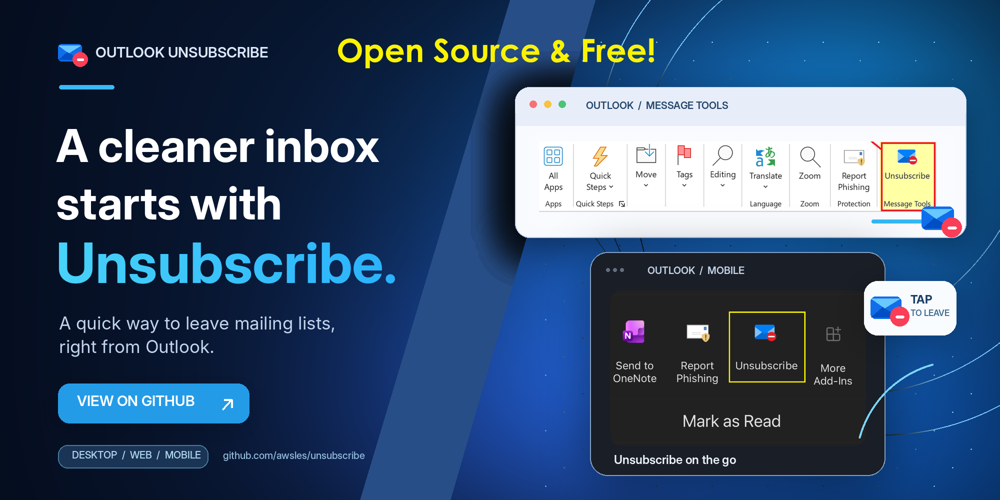

# Outlook Unsubscribe
Tired of junk email?  Me too! Even being conscious with where I share my email, I was still getting 40+ spams a day. And there was  no "easy" way to go through an unsubscribe. You had to open the latest message from each sender and then hunt for the tiny "unsubscribe" link within the message. But did you know that most bulk email contains a hidden one-click unsubscribe? One click to that and you are removed. No login. No questions to answer.

I decided to create a Outlook add-in button that would find this hidden link and call it. I enhanced this with a fallback to look for "unsubscribe" within the message body. **Outlook Unsubscribe** is a lightweight Outlook web add-in that adds an **Unsubscribe** command to received email messages. It reads the standard mailing-list unsubscribe headers in the current message and uses the best unsubscribe method advertised by the sender.

The add-in supports **new Outlook**, **classic Outlook**, **Outlook on the web (OWA)**,
and Outlook on **iOS and Android**. Desktop and web clients use a ribbon
command; mobile clients use an Outlook mobile command that opens a compact task
pane.

## Cleaning up SPAM
Once you have the add-in in place, the next step is to go through existing email. The best way I have found to do this is to SORT your email by SENDER. For each sender, select the most recent email and then click UNSUBSCRIBE. In my case, I then deleted that email from that sender and proceeded to the next. You may have different message types from the same sender, so sometimes a couple of targeted UNSUBSCRIBEs are needed. Be careful not to unsubscribe from important email (like notices from your bank). Generally, such important email does not have an unsubscribe option but sometimes it does. And if you're on a roll cleaning up, you may inadvertently unsubscribe from something you want to keep.

## How does it work?
Email originating via a subscription often includes a hidden **List-Unsubscribe** header that contains a link for unsubscribing from the associated subscription. This may be in addition to a *Click _here_ to unsubscribe* which appears in the email body.

This Outlook add-in provides an **Unsubscribe** button that appears when reading email in Outlook. When clicked, this button
looks for the List-Unsubscribe header and, if present, will launch a mini-browswer to that web page. In some cases, the Unsubscribe
does not display a page but simpy just accepts the unsubscribe action.

You should only have to do this for each unique sender & subscription that you want to unsubscribe from.
IT is best to choose the most recent email from that sender to use the unsubscribe button in.

For more detail,see [*How it Works*](https://github.com/awsles/unsubscribe/blob/main/How%20it%20Works.md].

## How long does it take to be unsubscribed?
Often, the unsubscribe take effect immediately. In other cases, it can take days for the venodr to honor the request.

## Does it work with GMAIL?
This UNSUBSCRIBE plug-in only works with Microsoft 365 personal and work accounts. It does not work with GMAIL. 

## It did not find the Unsubscribe in the email but I can see it
If there is no one-click unsubscribe option in the email headers, then the add-in attempts to find an unsubscribe option within the body of the message. Often, this is obvious. Sometimes however, it is not. For example, if the text is "Remove me" instead of "unsubscribe". I will periodically update the plug-in to reflect different use cases (you will need to manually update the plug-in to get the latest version). 

---

# INSTALLATION - Single User
The add-in is currently installed by *sideloading* a Manifest file (`manifest.xml`) file into Outlook.
This is done by using the WEB version of Outlook (often called OWA for Outlook Web Access). It can take a few hours for the plug-in to propagate to your desktop and mobile Outlook (though often it is a couple of minutes if you fully close and re-open Outlook).

## 1. Download `manifest.xml`
Download the current manifest from the project repository in GitHub:

https://github.com/awsles/unsubscribe/blob/main/manifest.xml

CLick the link to open the file and choose **Download raw file**, then save it somewhere convenient on your PC, such as your **Downloads** folder.

You can also view the deployed copy here:
https://awsles.github.io/unsubscribe/manifest.xml

Outlook requires a local XML file for manual sideloading; Microsoft's current sideloading interface does not offer the **Add from URL** option for individual use.

## 2. Open the Outlook add-in sideloading page
In a web browser, open:

https://aka.ms/olksideload

Sign in with the **same Microsoft account/mailbox that you use in Outlook**.
Give the page a moment to fully load the "Add-Ins for Outlook" popup window. 

The **Add-Ins for Outlook** dialog should open.

## 3. Open My add-ins
In the Add-Ins for Outlook dialog:

1. Select **My add-ins**.
2. Scroll to the **Custom Addins** section near the bottom.
3. Select **Add a custom add-in**.
4. Select **Add from File**.

## 4. Select the manifest
Choose the `manifest.xml` file you downloaded in Step 1.

Accept the installation/security prompts.

The add-in is now associated with your Outlook mailbox. Microsoft states that an add-in sideloaded through this dialog should also become available in supported Outlook desktop clients that use the same mailbox.

> **Classic Outlook note:** A manually sideloaded add-in can occasionally take up to 24 hours to appear in classic Outlook because of client caching. New Outlook and Outlook on the web normally reflect the installation much sooner.

## 5. Find the Unsubscribe command
Open a **received email message** in Outlook, based on the version of Outlook you are using:

### New Outlook for Windows / Outlook on the web

1. Select the message.
2. In the message action bar, select **Apps**.
3. Look for **Outlook Unsubscribe** or **Unsubscribe**.

You may be able to pin the command depending on your Outlook configuration.

### Classic Outlook for Windows
Open a received message and look for the **Unsubscribe** command on the message's add-in/ribbon surface. If it does not appear immediately after installation, restart Outlook and allow time for its add-in cache to refresh.

## 6. Test it
For the best test, open a legitimate newsletter or mailing-list message that provides a `List-Unsubscribe` header (i.e., look for some junk mail).

Select **Unsubscribe**.

Depending on the message, the add-in will either:

- Submit an RFC 8058 one-click unsubscribe request
- Open the sender's unsubscribe webpage
- Open a pre-addressed unsubscribe email draft, OR
- Display a message saying that no supported unsubscribe method was found.

## I don't see the Unsubscribe button
Once you installed the add-in, you should refresh your Outlook web.
The Outlook Unsubscribe only appears when you are reading an email.
If you don't see the icon, then look for an icon that looks like a stove top with 4 burners (basically a square with 4 small circles within).
Click that and you should then see Outlook Unsubscribe.

## Updating the add-in

Most JavaScript/HTML changes are loaded from the hosted GitHub Pages site automatically. However, if `manifest.xml` itself changes, Outlook may continue using the copy that was previously sideloaded.

When the manifest version changes:

1. Download the new `manifest.xml`.
2. Remove the existing custom add-in from **My add-ins** if necessary.
3. Sideload the new manifest using **Add from File** again.

The manifest's `<Version>` value can be used to verify that you have the expected release.

## Removing the add-in

To uninstall the sideloaded add-in:

1. Open https://aka.ms/olksideload 
2. Select **My add-ins**.
3. Locate **Outlook Unsubscribe** under your custom add-ins.
4. Remove the add-in.

---

# INSTALLATION - M365 Tenant-wide
You can deploy an Outlook add-in to all users in your Microsoft 365 tenant using the Microsoft 365 Admin Center. This is called Centralized Deployment and allows administrators to install and manage add-ins across the organization without manually installing them on each user's computer. YOu will need Exchange Administrator or Global Administrator privileges to do this.

## Steps
1. Sign in to the [Microsoft 365 Admin Center](https://admin.microsoft.com/).
1. Navigate to **[Settings → Integrated apps](https://admin.cloud.microsoft/#/Settings/IntegratedApps)**.
1. Scroll down below the *Popular apps to be deployed* section and click **Upload custom apps**.
1. Select the **App type** to be "Office Add-in" in the drop-down menu.
1. Choose **Provide link to manifest file** and enter: `https://awsles.github.io/unsubscribe/manifest.xml`
1. Click the **Validate** button to verify the manifest. This may take a couple of minutes.
1. Click **Next**
1. Under user assignment, select Everyone to deploy the add-in tenant-wide.
1. Click Deploy and complete the wizard.
1. You can return to the **Integrated apps** menu and see "Outlook Unsubscribe" in the list of apps. The context menu allows you to change the users to which the plug-in is made available.

## Verify Installation
1. Open Outlook (desktop or web or mobile).
2. Open a received email.
3. Look for Outlook Unsubscribe in the Outlook toolbar or Apps menu.
NOTE: Deployment may take 24–72 hours to appear for all users. Restarting Outlook may help.

Reference: [Microsoft's official add-in deployment instructions](https://learn.microsoft.com/en-us/microsoft-365/admin/manage/manage-deployment-of-add-ins?view=o365-worldwide).

## uninstall

---

### Update History

- v1.0.0.4 -- *Initial Version*
- v1.0.0.5 -- Add support for extracting Unsubscribe link from message body
- v1.0.0.6 -- Add promptBeforeOpen:false in Office.context.ui.displayDialogAsync() to eliminate "Outlook Unsubscribe wants to display a new window."
- v1.0.0.7 -- Rolled back v1.0.0.6 changes
- v1.0.0.8 -- Standardize mailto unsubscribe drafts and identify the original recipient in the body
- v1.0.0.9 -- Wait for Outlook to open mailto drafts before completing the command
- v1.0.0.10 -- Add Outlook mobile command surface and mobile unsubscribe task pane
- v1.0.0.11 -- Detect unsubscribe wording immediately before or after a hyperlink

### Known Issues

1. Outlook does not load the primary icon for the add-in.  Unsure why.
1. Users have to accept "Outlook Unsubscribe wants to display a new window." in some cases. If promptBeforeOpen:false is added to Office.context.ui.displayDialogAsync(), then the window open fails.  Not sure if there is another work-around.
1. Extraction of embedded Unsubscribe links is based on keywords, so it can miss some.
1. On mobile clients that don't expose `getAllInternetHeadersAsync()`, header-only `List-Unsubscribe` methods aren't available; the add-in scans the message body instead.

